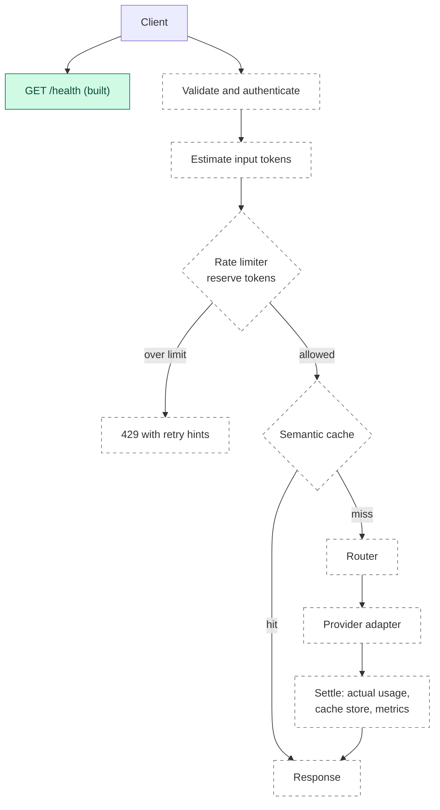

# Tollgate

**A planned LLM gateway with token-aware rate limiting, model routing and semantic caching. Today only `GET /health` is built; the design, decisions and open questions are written down.**

[](https://github.com/apoorvrajdev/tollgate/actions/workflows/ci.yml)


[](LICENSE)

**Status as of Phase 0, November 2026.** Only `GET /health` is implemented. The gateway features below are planned, and every section says which is which. This README is updated at the end of each phase.

## At a glance

| | |
| --- | --- |
| **Target** | One OpenAI-compatible API (`/v1/chat/completions`) in front of several model providers. Planned; ADR-0004 is Proposed |
| **Built today** | A FastAPI app with `GET /health`; a one-command check (lint, format, strict types, tests); local commit guards; architecture, decision and task documents |
| **Planned** | Token-aware rate limiting (Phase 1), model routing (Phase 2), semantic caching (Phase 3), Docker Compose, observability and load benchmarks (Phase 4), demo and write-up (Phase 5) |
| **Toolchain** | Python 3.13, FastAPI, ruff, mypy in strict mode, pytest |
| **Delivery** | Pull requests only, protected `main`, merge commits. CI runs on every pull request and on pushes to `main`, and `lint and test` is a required check on `protect-main` |
| **Results** | Not measured yet. See [Results](#results) |
| **Licence** | MIT |

## Why it is interesting

- **The delivery workflow is enforced, not just described (built).** Since ADR-0002, `main` changes only through a pull request (the first skeleton commit predates it). The `protect-main` ruleset has no bypass actors, so that includes me. Local commit guards reject a mismatched author identity, attribution trailers in commit messages and files that must not be committed. Each decision is an ADR with a status.
- **Three gateway features, each planned.** Token-aware rate limiting (Phase 1) will count tokens per time window per key, not only requests. Model routing (Phase 2) will pick a provider and model by explicit rules, with fallback. Semantic caching (Phase 3) will answer a request from the cache when it is close in meaning to an earlier one. The open question of how the limiter talks to Redis is written down before any limiter code exists.
- **Evidence first.** No latency, hit-rate or quality figure goes in this repository unless it comes from a recorded, reproducible run. ADR-0005 (Proposed) adds a committed API contract snapshot and a mutation check for every task that adds tests.

## Status

| Built and merged on `main` | Not built yet |
| --- | --- |
| `GET /health` on a FastAPI app | `/v1/chat/completions`, authentication, providers |
| `python scripts/check.py`: ruff, ruff format, mypy strict, pytest | Rate limiter, router, semantic cache |
| Commit guards in `.githooks/` (author identity, trailers, blocked files) | The OpenAPI snapshot test, tests for the commit guards |
| `docs/`: architecture, decisions, tasks, setup | Redis, Docker, metrics, benchmarks |
| CI: the `lint and test` job on every pull request and on pushes to `main`, a required check on `protect-main` | |

## The problem

A plain proxy forwards requests. Three things it does not do are the subject of this project: it does not limit by how much a request costs, it does not choose between models, and it does not reuse an earlier answer to a similar question.

*Design rationale, not a measurement:* LLM requests differ a great deal in size, so a limit that counts requests treats a short prompt and a long one the same. Counting tokens per window is intended to follow the cost of the work more closely.

## Planned architecture

This diagram is the request flow in [`docs/ARCHITECTURE.md`](docs/ARCHITECTURE.md), plus the built `/health` endpoint. Solid green is built. Dashed is planned. The client is the caller, outside the gateway.



| Stage | What it will do | Phase |
| --- | --- | --- |
| API layer | `/v1/chat/completions`, request and response models, error shape | 0-1 |
| Providers | Adapters behind one interface: mock first, then Ollama, then OpenAI and Anthropic (ADR-0004, Proposed) | 1-2 |
| Token counting | Estimate before the call, settle with the provider's reported usage afterwards | 1 |
| Rate limiter | Per-key token budget per window on a shared state store. Redis is planned; a Phase 1 ADR decides how the limiter talks to it | 1 |
| Router | Rule-based choice of provider and model, with fallback when a provider fails | 2 |
| Semantic cache | Embedding of the prompt, similarity lookup, thresholds, invalidation | 3 |
| Operations | Docker Compose, metrics, structured logs, load benchmarks | 4 |

## Design decisions

All are in [`docs/DECISIONS.md`](docs/DECISIONS.md).

| ADR | Decision | Status |
| --- | --- | --- |
| 0001 | I chose a single-author repository with commit identity enforced by local hooks | Accepted |
| 0002 | I chose pull requests merged with a merge commit, so every atomic commit stays visible | Accepted |
| 0003 | I chose Python 3.13 only, ruff, mypy strict, pytest, one check script and plain pip with pinned requirements | Accepted |
| 0004 | An OpenAI-compatible API; providers added in a fixed order; no paid calls in tests | Proposed |
| 0005 | A contract snapshot, mutation checks and evidence-first numbers | Proposed |

Still to be decided: how the rate limiter talks to Redis (before any limiter code is written) and the deployment target (Phase 4).

## Results

**Not measured yet.** There is no recorded run in this repository, so it contains no latency, hit-rate, cost or quality numbers. They will be published only from reproducible runs, each recorded with:

- the workload and the number of requests;
- the providers and models used;
- for the semantic cache, the embedding model and the similarity threshold;
- the hardware, the Python version and the pinned dependencies.

Planned measurements: rate-limiter behaviour against a real Redis in CI (Phase 1); cache hit rate and wrong-hit rate on a small labelled evaluation set (Phase 3); latency under load (Phase 4). Until the Phase 1 test against real Redis exists and passes, I will describe the limiter only as unit-tested against a fake.

## Roadmap

Phases 1 to 5 are planned. Phase 0 is complete. Details and acceptance criteria are in [`docs/TASKS.md`](docs/TASKS.md).

| Phase | Scope | State |
| --- | --- | --- |
| 0 | Foundation: toolchain (T-001), CI (T-003), tests for the commit guards (T-002), typed app and OpenAPI snapshot (T-004) | T-000, T-001, T-002, T-003 and T-004 done |
| 1 | Token-aware rate limiting: token counting, a token bucket on a shared store (Redis planned; an ADR decides the client), 429 with rate-limit headers, a mock provider, `/v1/chat/completions` | Planned |
| 2 | Model routing: rules, fallback on provider failure, Ollama, then OpenAI and Anthropic adapters | Planned |
| 3 | Semantic caching: embeddings, similarity lookup, thresholds, invalidation, a minimal evaluation harness | Planned |
| 4 | Docker Compose, observability, reproducible load benchmarks, deployment ADR | Planned |
| 5 | Demo and write-up | Planned |

Backlog: a test that runs the official OpenAI Python SDK against the gateway with the mock provider.

## Limitations

- The gateway does not exist yet. There is no chat endpoint, no provider, no authentication and no rate limiting.
- The OpenAI-compatible API and the provider order are Proposed decisions, not accepted ones.
- Pull requests #1 to #4 were merged before CI existed, and #5 and #6 before `lint and test` was a required check; CI had passed on both. The task log records the exceptions for #1 to #6.
- The commit guards run locally and need Node.js. They protect my own commits, and a clone without them has no such protection.
- The pinned dependencies were generated on Windows. CI installs every pin from Linux wheels on Ubuntu.
- The documented setup is Windows with Git Bash. CI runs the checks on Ubuntu and passes.
- Python 3.13 is the only supported version.

## Tech stack

| | Built today | Planned |
| --- | --- | --- |
| **Language and API** | Python 3.13, FastAPI 0.162.2, uvicorn 0.54.0 | OpenAI-compatible chat completions |
| **Quality** | pytest 9.2.0, httpx 0.28.1, ruff 0.17.4, mypy 2.4.1 (strict); OpenAPI snapshot test; CI on Python 3.13 in GitHub Actions | None |
| **Commit guards** | Node.js scripts in `.githooks/`, with tests | None |
| **State and providers** | None | Redis (pending the Phase 1 ADR); mock, Ollama, OpenAI and Anthropic adapters |
| **Operations** | None | Docker Compose, metrics, structured logs (Phase 4) |

## Run locally

Requires a standard Windows Python 3.13 from python.org and Git Bash. Do not use the MSYS2 `python`: its platform is `mingw_x86_64_ucrt_gnu`, so pip finds no prebuilt wheels and tries to compile. `py -0p` lists the right one. CI runs the checks on Ubuntu and passes.

```bash
git clone https://github.com/apoorvrajdev/tollgate.git
cd tollgate
py -3.13 -m venv .venv
source .venv/Scripts/activate
python -m pip install --only-binary=:all: -r requirements-dev.txt
python scripts/check.py
uvicorn --factory app.main:create_app --reload
curl localhost:8000/health   # {"status":"ok"}
```

`--only-binary=:all:` makes pip fail instead of compiling from source. Interactive API docs are at `http://localhost:8000/docs` while the server runs. Setup details, how to update the pinned requirements and how to enable the commit hooks are in [`docs/setup.md`](docs/setup.md).

## Checks

`python scripts/check.py` runs five steps in order, stops at the first failure and names it:

1. `ruff check .`
2. `ruff format --check .`
3. `mypy` (strict)
4. `contract` (the live OpenAPI document must equal the committed snapshot)
5. `pytest` (every other test)

## Repository layout

```text
tollgate/
├── app/                  # gateway code (today: the app and GET /health)
│   ├── __init__.py
│   └── main.py
├── docs/
│   ├── ARCHITECTURE.md   # target design, interfaces, conventions
│   ├── DECISIONS.md      # ADRs with status
│   ├── TASKS.md          # phases, task cards, log
│   └── setup.md          # setup, pins, commit hooks
├── scripts/
│   └── check.py          # the single check command
├── tests/
│   ├── __init__.py
│   └── test_health.py
├── .githooks/            # commit guards (need Node.js)
├── .gitattributes
├── .gitignore
├── LICENSE
├── pyproject.toml        # project metadata, ruff, mypy, pytest settings
├── requirements.txt      # runtime pins
├── requirements-dev.txt  # runtime plus test and lint pins
└── README.md
```

## Engineering workflow

- **Pull requests only.** Since ADR-0002, nothing is pushed to `main` directly; the first skeleton commit predates it. The `protect-main` ruleset requires a pull request, allows merge commits only, blocks force pushes and branch deletion, and has no bypass actors. I read these rules back on 2026-11-09, and the task log records the result.
- **Atomic Conventional Commits.** One logical change per commit, for example `docs(tasks): complete T-001`. Each branch is merged with a merge commit, so the individual commits stay in the history.
- **One author, enforced locally.** Hooks check the author and committer email and reject attribution trailers in commit messages (ADR-0001).
- **Task cards.** Work comes from [`docs/TASKS.md`](docs/TASKS.md). Each card has acceptance criteria that can be checked with evidence, and a task is marked done in the pull request that delivers it.
- **CI is in place.** The `lint and test` job in GitHub Actions runs the same five checks as `scripts/check.py` on Ubuntu with Python 3.13, on every pull request and on pushes to `main`. It is a required check in the `protect-main` ruleset.

## Documentation

| Document | What it covers |
| --- | --- |
| [`docs/ARCHITECTURE.md`](docs/ARCHITECTURE.md) | Request flow, planned interfaces, conventions |
| [`docs/DECISIONS.md`](docs/DECISIONS.md) | Decision records and their status |
| [`docs/TASKS.md`](docs/TASKS.md) | Phases, task cards, acceptance criteria, log |
| [`docs/setup.md`](docs/setup.md) | Setup, updating pins, enabling the commit hooks |

---

Built by [apoorvrajdev](https://github.com/apoorvrajdev) · [MIT](LICENSE) · [apoorvrajmgr@gmail.com](mailto:apoorvrajmgr@gmail.com)
