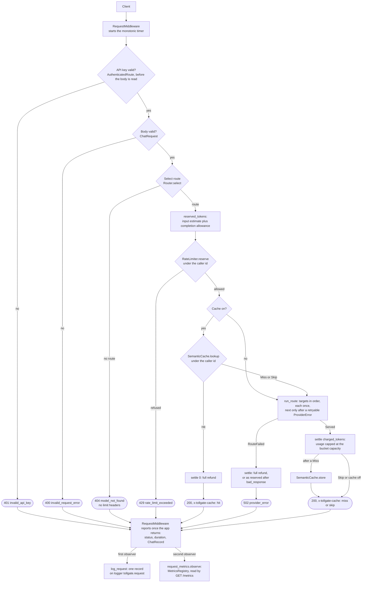

# Tollgate

**An OpenAI-compatible LLM gateway with token-aware rate limiting, model routing and semantic caching, built to be measured honestly: every measured figure here comes from a recorded run, and runs that failed their own validity rule are published as invalid.**

[](https://github.com/apoorvrajdev/tollgate/actions/workflows/ci.yml)


[](LICENSE)

## What I found

Three results, each told in full, with its method and limits, in [`docs/findings.md`](docs/findings.md).

- **No safe cache threshold** ([Finding 1](docs/findings.md#finding-1-no-safe-cache-threshold)). With the `all-minilm` embedding model on 80 hand-written prompt pairs, no cosine threshold below 1.00 kept every different-meaning pair out: at 0.99, 2 of 40 same-meaning pairs hit, and so did 4 of 40 different-meaning ones. A changed negation, number or direction scores almost like a rewording, so no threshold is recommended.
- **The lag rule on Windows** ([Finding 2](docs/findings.md#finding-2-the-lag-rule-on-windows)). A load run is valid only if the generator's lag p99 is at most 10% of the latency p99. In all 15 load runs at 40 requests/s, every one invalid, the lag p99 was 14.0 to 16.1 ms, consistent with the Windows timer tick of about 15.6 ms (external, not measured here). If that tick is the floor, as the invalid runs' lag p99 suggests, the rule could pass only with a latency p99 above about 150 ms.
- **The throughput ceiling, not reproduced** ([Finding 3](docs/findings.md#finding-3-the-throughput-ceiling)). In invalid ramp runs, scenario B (the gateway calling a fake upstream through its `openai` adapter) achieved 46.43 to 54.09 requests/s against targets of 100/s and above. A re-run of B with the memory limiter at 50/s and 100/s, with the A and C controls at 100/s, concluded "not reproduced on commit `e280d37`": B kept up with 100/s in run `ceiling-B-memory-r100.json`, itself invalid like all four re-runs. The invalid ramp cases of B with the Redis limiter, and of B at 200/s and above, were not re-run, and the cause of the earlier ceiling is unknown.

## See it run

[`docs/demo.md`](docs/demo.md) is one recorded run on the Docker Compose stack, with every command and its unedited output. The bucket was set to 60 tokens a minute for that run. A chat completion through the mock provider, then a second key whose bucket runs out (`...` marks an elision):

```text
HTTP/1.1 200 OK
...
x-ratelimit-limit-tokens: 60
x-ratelimit-remaining-tokens: 50
x-ratelimit-reset-tokens: 10s
x-tollgate-provider: mock
x-tollgate-fallbacks: 0
x-tollgate-cache: skip
...
```

```text
HTTP/1.1 429 Too Many Requests
...
x-ratelimit-limit-tokens: 60
x-ratelimit-remaining-tokens: 8
x-ratelimit-reset-tokens: 52s
retry-after: 29
...
{"error":{"message":"Rate limit reached for tokens: limit 60, requested 37. Try again in 29s.","type":"tokens","param":null,"code":"rate_limit_exceeded"}}
```

The demo also shows the 401 without a key, a `/metrics` excerpt and the JSON log lines of the same requests.

## What it does

*Design rationale, not a measurement:* LLM requests differ a great deal in size, so a limit that counts requests treats a short prompt and a long one the same. Counting tokens per key is intended to follow the cost of the work more closely.

| Feature | Built | Decisions |
| --- | --- | --- |
| Chat completions | Non-streaming `POST /v1/chat/completions` in the OpenAI request and error shape, and `GET /health` | ADR-0004, ADR-0008, ADR-0009 |
| API keys | `Authorization: Bearer` keys, kept only as SHA-256 digests, with one fixed 401 for every failure | ADR-0008 |
| Token-aware rate limiting | A token bucket per key, in memory or in Redis through one Lua script. A request reserves an estimate before the provider is called and settles with the reported usage after, capped at the capacity. 429 with `Retry-After`, and `x-ratelimit-*-tokens` headers | ADR-0006, ADR-0007, ADR-0012 |
| Model routing | A JSON route table maps each model to ordered provider targets, falling back on a retryable failure. Providers: the in-process mock, and adapters for Ollama, OpenAI and Anthropic on plain httpx, with a reply size cap | ADR-0010, ADR-0011, ADR-0013 |
| Semantic cache | Optional and off by default (ADR-0015): an Ollama embedder, cosine similarity in the standard library, an in-process store with TTL and size bounds, and an `x-tollgate-cache` header. An eval harness over 80 labelled pairs | ADR-0014, ADR-0015 |
| Observability | One JSON log line per request from bounded fields only, and Prometheus metrics on `GET /metrics` behind their own token | ADR-0016 |
| Deployment | A non-root image on a base image pinned by digest, and a Compose stack (gateway and Redis, Ollama opt-in) published on `127.0.0.1` only, both checked in CI | ADR-0017, ADR-0019 |
| Load benchmarks | A fixed-rate generator measured from each request's due time, a fake upstream, and committed JSON reports | ADR-0018 |

Not built: streaming, routing by cost, latency or health, a cache shared between processes, TLS, a published image and a hosted demo. [`docs/ARCHITECTURE.md`](docs/ARCHITECTURE.md#1-overview) names the decision or Backlog item behind each. Development is complete through Phase 4; Phase 5 adds only documentation.

## Architecture

One chat completion, as [`docs/ARCHITECTURE.md`](docs/ARCHITECTURE.md#2-request-flow-built) draws it from `app/api/chat.py`. The same document has the deployment diagram and the package diagram.



## How it was built

- **Pull requests only** (ADR-0002). Since that decision (the first skeleton commit predates it), `main` has changed only through a pull request merged with a merge commit, so each atomic commit stays visible. The `protect-main` ruleset has no bypass actors, so that includes me, and requires the `lint and test` and `container` checks (read back on 2026-11-29). Local commit guards reject a wrong author identity and attribution trailers (ADR-0001).
- **Mutation checks** (ADR-0005). Every task that adds tests is checked by mutating the code under test on a scratch copy; a mutant that survives means a missing or vacuous test. The Log in [`docs/TASKS.md`](docs/TASKS.md) records each mutation run's result.
- **A contract snapshot** (ADR-0005). The live OpenAPI document must equal a committed snapshot, and the snapshot changes only in a task whose card says the contract changes.
- **Evidence-first figures** (ADR-0005, ADR-0018). A figure is published only from a recorded run with its settings, and a run that fails its validity rule is published as invalid, never tuned until it passes.
- **CI.** On `main` at `e25f5f7`, CI run `46175054030` passed: 15 contract tests; 2,477 other tests passed, with 45 deselected; those 45 shared limiter cases then passed against a `redis:7.4.12` service. The `container` job linted the `Dockerfile`, built and started the Compose stack and passed its five smoke requests.

| | |
| --- | --- |
| **Language and API** | Python 3.13, FastAPI 0.162.2, pydantic 2.14.3, uvicorn 0.54.0 |
| **State and providers** | redis-py 8.1.0 (Redis 7.4.12 in CI and in Compose), httpx 0.28.1 for every provider adapter and the Ollama embedder |
| **Quality** | pytest 9.2.0, fakeredis 2.40.0 (with lupa 2.8), ruff 0.17.4, mypy 2.4.1 (strict), GitHub Actions |
| **Operations** | Docker image and Compose stack, a JSON log formatter and Prometheus text metrics written with the standard library |
| **Commit guards** | Node.js scripts in `.githooks/`, with tests |

## Running it locally

**With Docker Compose** (the gateway, Redis and the mock provider; no provider key, and the gateway calls no outside service):

```bash
git clone https://github.com/apoorvrajdev/tollgate.git
cd tollgate
TOLLGATE_API_KEYS="<your keys>" TOLLGATE_METRICS_TOKEN="<a token of 32 or more characters>" \
  docker compose up --wait
curl localhost:8000/health   # {"status":"ok"}
docker compose down
```

`TOLLGATE_API_KEYS` is a comma-separated list. The metrics token must be at least 32 characters and differ from every key, or the gateway refuses to start.

**With bare uvicorn** (a standard Windows Python 3.13 from python.org and Git Bash; `py -0p` lists it. Not the MSYS2 `python`, which finds no prebuilt wheels):

```bash
py -3.13 -m venv .venv
source .venv/Scripts/activate
python -m pip install --only-binary=:all: -r requirements-dev.txt
python scripts/check.py
TOLLGATE_API_KEYS="<your keys>" TOLLGATE_TOKENS_PER_MINUTE=60000 \
  uvicorn --factory app.main:create_app
```

`python scripts/check.py` runs ruff, ruff format, mypy (strict), the contract snapshot test and pytest, and stops at the first failure. Without a route file the server uses the mock provider. Chat completions need `Authorization: Bearer <key>`, and interactive API docs are at `http://localhost:8000/docs` while the server runs. Every variable, the route table, the Redis backend, the semantic cache, metrics, logs and the benchmarks are in [`docs/setup.md`](docs/setup.md).

## Limitations

- **Real providers.** The Ollama, OpenAI and Anthropic adapters are tested only against hand-written fakes. The one real call recorded is a manual request through a local Ollama; OpenAI and Anthropic have never been called. Streaming is rejected with a 400, request fields the gateway does not model (`stop`, `top_p`, `tools` and similar) are ignored rather than forwarded or rejected, and the API is not yet checked against the official OpenAI SDK (Backlog).
- **The semantic cache** has no recommended threshold (Finding 1), so turning it on means choosing one that will sometimes answer a different question. Each process has its own cache, a restart empties it, and there is no purge or per-request bypass. A hit's `usage` describes the answer as first produced, and a hit costs no tokens, so repeated cached prompts are not limited while the reservation succeeds (Backlog).
- **The benchmarks** come from one Windows 11 machine with the generator on it, and every load, ramp and ceiling run is invalid under ADR-0018. No valid load, ramp or ceiling run has been obtained, and a Linux or WSL2 generator is untested. The latency the gateway adds is reported as B minus A, which includes the `openai` adapter and its HTTP client. The throughput ceiling seen in the invalid ramp runs is unexplained (Finding 3).
- **The token estimate** is a character heuristic (about four characters per token plus overhead per message), rough and mostly for English; the provider's reported usage corrects it on settle.
- **The `x-ratelimit-*-tokens` headers** follow OpenAI's convention, a vendor convention and not a standard (ADR-0008). On a 200 they show the balance after the reservation, so the balance after settling appears on the next request. An authenticated 400 and a 401 carry no limit headers.
- **Redis** is tested only against 7.4.12, in CI and in the Compose stack: no other version, no cluster and no managed service.
- **One process per container.** Metrics and the cache are per process. More than one gateway needs the Redis limiter. The gateway serves plain HTTP: a host reachable from outside needs a reverse proxy for TLS. There is no published image and no hosted demo (ADR-0019).
- **Known gaps** (Backlog): a malformed `TOLLGATE_REDIS_URL` scheme gives redis-py's own `ValueError`; a Redis outage gives a 500; a failure while settling after a successful provider call loses the completion; a client that disconnects mid-request stays charged; each request hashes the API key twice; there is no request id to follow one request across systems.
- `/openapi.json` and `/docs` need no API key.
- Pull requests #1 to #4 were merged before CI existed, and #5 and #6 before `lint and test` was a required check; CI had passed on both. The task log records these exceptions.
- The commit guards run locally and need Node.js; a clone without them has no such protection. The documented setup is Windows with Git Bash; the pins were generated there, and CI installs them from Linux wheels on Ubuntu and passes. Python 3.13 is the only supported version.

## Documentation

| Document | What it covers |
| --- | --- |
| [`docs/findings.md`](docs/findings.md) | The three findings: question, method, result, meaning and limits |
| [`docs/benchmarks.md`](docs/benchmarks.md) | Every load, ramp and ceiling run with its settings and validity, and the cache benchmarks |
| [`docs/demo.md`](docs/demo.md) | One recorded run of the Compose stack, command by command |
| [`docs/ARCHITECTURE.md`](docs/ARCHITECTURE.md) | Request flow, deployment and package diagrams, interfaces, conventions, and the [repository layout](docs/ARCHITECTURE.md#5-repository-layout-built) |
| [`docs/DECISIONS.md`](docs/DECISIONS.md) | Decision records and their status |
| [`docs/TASKS.md`](docs/TASKS.md) | Phases, task cards, acceptance criteria, the Backlog and the log |
| [`docs/setup.md`](docs/setup.md) | Setup, configuration, real providers, the semantic cache, Compose, metrics, logs, benchmarks, commit hooks |
| [`docs/cache-eval.md`](docs/cache-eval.md) | How the cache is evaluated, the dataset and its recorded runs |

### Design decisions

| ADR | Decision | Status |
| --- | --- | --- |
| 0001 | I chose a single-author repository with commit identity enforced by local hooks | Accepted |
| 0002 | I chose pull requests merged with a merge commit, so every atomic commit stays visible | Accepted |
| 0003 | I chose Python 3.13 only, ruff, mypy strict, pytest, one check script and plain pip with pinned requirements | Accepted |
| 0004 | An OpenAI-compatible API; providers added in a fixed order; no paid calls in tests | Accepted |
| 0005 | A contract snapshot, mutation checks and evidence-first numbers | Accepted |
| 0006 | redis-py with one Lua token-bucket script, tested on fakeredis and on a real Redis server in CI | Accepted (amended by 0017) |
| 0007 | Estimated tokens, a token bucket, and reserve then settle | Accepted (amended by 0010, 0012 and 0014) |
| 0008 | Bearer authentication, OpenAI-style errors and `x-ratelimit-*-tokens` headers | Accepted (amended by 0009, 0010 and 0011) |
| 0009 | Validation error codes and the `param` format | Accepted |
| 0010 | Provider adapters on plain httpx, with translation rules and a failure taxonomy | Accepted (amended by 0013) |
| 0011 | A route table file, with ordered fallback on retryable failures | Accepted (amended by 0014) |
| 0012 | A settle charge capped at the bucket capacity | Accepted |
| 0013 | A size cap on a provider reply | Accepted (amended by 0016) |
| 0014 | What the semantic cache compares, who shares an entry, what a hit costs, and that the threshold comes from a measurement | Accepted (amended by 0016) |
| 0015 | Embeddings from a local Ollama, cosine in the standard library, the cache in process memory | Accepted |
| 0016 | A JSON request log and Prometheus metrics with the standard library, from bounded fields only | Accepted |
| 0017 | A container image, Docker Compose, and one host as the deployment target | Accepted (amended by 0019) |
| 0018 | Load benchmarks at a fixed arrival rate measured from the due time, against a fake upstream, recorded runs only | Accepted |
| 0019 | No published image and no hosted demo; the demo is a recorded local run | Accepted |

---

Built by [apoorvrajdev](https://github.com/apoorvrajdev) · [MIT](LICENSE) · [apoorvrajmgr@gmail.com](mailto:apoorvrajmgr@gmail.com)
