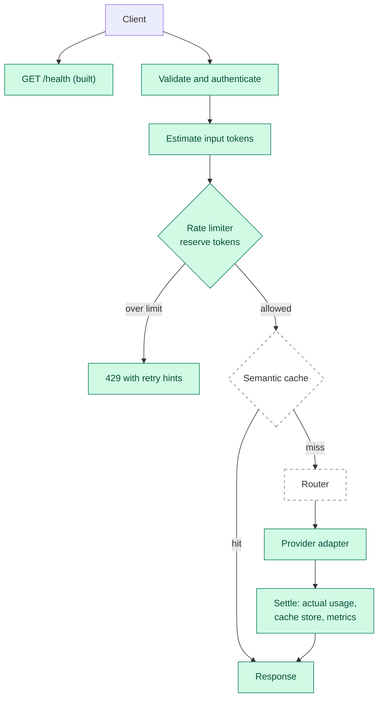

# Tollgate

**An LLM gateway with token-aware rate limiting, model routing and semantic caching. Today it serves an OpenAI-style chat completions endpoint from a mock provider, behind API key authentication and a per-key token limit. Routing, caching and real providers are planned.**

[](https://github.com/apoorvrajdev/tollgate/actions/workflows/ci.yml)


[](LICENSE)

**Status as of Phase 1, November 2026.** `GET /health` and non-streaming `POST /v1/chat/completions` (mock provider only) are implemented, with API key authentication and token-aware rate limiting. Routing, caching, real providers and benchmarks are planned, and every section says which is which. This README is updated at the end of each phase.

## At a glance

| | |
| --- | --- |
| **Target** | One OpenAI-compatible API (`/v1/chat/completions`) in front of several model providers (ADR-0004, Accepted) |
| **Built today** | `GET /health`; non-streaming `POST /v1/chat/completions` answered by a deterministic mock provider; API key authentication; a per-key token bucket (in memory or in Redis) that reserves an estimate before the call and settles with the reported usage after; 429 and 502 responses and `x-ratelimit-*-tokens` headers; a committed OpenAPI snapshot; a one-command check; local commit guards; architecture, decision and task documents |
| **Planned** | Model routing (Phase 2), semantic caching (Phase 3), Docker Compose, observability and load benchmarks (Phase 4), demo and write-up (Phase 5) |
| **Toolchain** | Python 3.13, FastAPI, ruff, mypy in strict mode, pytest |
| **Delivery** | Pull requests only, protected `main`, merge commits. CI runs on every pull request and on pushes to `main`, and `lint and test` is a required check on `protect-main` |
| **Results** | Not measured yet. See [Results](#results) |
| **Licence** | MIT |

## Why it is interesting

- **The delivery workflow is enforced, not just described (built).** Since ADR-0002, `main` changes only through a pull request (the first skeleton commit predates it). The `protect-main` ruleset has no bypass actors, so that includes me. Local commit guards reject a mismatched author identity, attribution trailers in commit messages and files that must not be committed. Each decision is an ADR with a status.
- **Token-aware rate limiting (built).** The limit counts tokens per key, not requests. A request reserves an estimate of its prompt plus its `max_tokens` allowance before the provider is called, and the provider's reported usage is charged or refunded afterwards; if the provider fails, the whole reservation is refunded. The bucket runs in memory or in Redis through one Lua script, and both implementations pass the same 45-case behaviour suite (ADR-0006, ADR-0007).
- **Two more gateway features, planned.** Model routing (Phase 2) will pick a provider and model by explicit rules, with fallback. Semantic caching (Phase 3) will answer a request from the cache when it is close in meaning to an earlier one.
- **Evidence first.** No latency, hit-rate or quality figure goes in this repository unless it comes from a recorded, reproducible run. ADR-0005 (Accepted) adds a committed API contract snapshot and a mutation check for every task that adds tests; the task log records each mutation table.

## Status

| Built and merged on `main` | Not built yet |
| --- | --- |
| `GET /health` and `POST /v1/chat/completions` (non-streaming, mock provider) on a FastAPI app | Real providers (Ollama, OpenAI, Anthropic), streaming |
| API key authentication (`Authorization: Bearer`) with one fixed 401 | Model routing and fallback |
| Token-aware rate limiting per key: estimate, reserve, settle, refund; 429 with `Retry-After`, 502, `x-ratelimit-*-tokens` headers | Semantic cache |
| In-memory and Redis limiters, one shared behaviour suite; the Redis limiter is also tested against Redis 7.4.12 in CI | Docker Compose, metrics, benchmarks |
| Validated settings from environment variables and an injected clock | Any measured latency, hit-rate or cost figure |
| `python scripts/check.py`: ruff, ruff format, mypy strict, contract snapshot, pytest | |
| Commit guards in `.githooks/`, with tests | |
| `docs/`: architecture, decisions, tasks, setup | |
| CI: the `lint and test` job on every pull request and on pushes to `main`, a required check on `protect-main` | |

## The problem

A plain proxy forwards requests. Three things it does not do are the subject of this project: it does not limit by how much a request costs, it does not choose between models, and it does not reuse an earlier answer to a similar question.

*Design rationale, not a measurement:* LLM requests differ a great deal in size, so a limit that counts requests treats a short prompt and a long one the same. Counting tokens per window is intended to follow the cost of the work more closely.

## Architecture

This diagram is the request flow in [`docs/ARCHITECTURE.md`](docs/ARCHITECTURE.md), plus the built `/health` endpoint. Solid green is built. Dashed is planned. The client is the caller, outside the gateway. The provider adapter today is the mock only, and settling today charges or refunds tokens; storing in a cache and metrics are planned.



| Stage | What it does or will do | Phase | State |
| --- | --- | --- | --- |
| API layer | `/v1/chat/completions`, request and response models, the OpenAI-style error shape | 0-1 | Built |
| Authentication | Bearer API keys from configuration, compared as SHA-256 digests | 1 | Built |
| Providers | Adapters behind one interface: the mock now, then Ollama, then OpenAI and Anthropic (ADR-0004) | 1-2 | Mock built |
| Token counting | A character heuristic estimates before the call; the provider's reported usage settles afterwards (ADR-0007) | 1 | Built |
| Rate limiter | Per-key token bucket, in memory or in Redis through one Lua script (ADR-0006, ADR-0007) | 1 | Built |
| Router | Rule-based choice of provider and model, with fallback when a provider fails | 2 | Planned |
| Semantic cache | Embedding of the prompt, similarity lookup, thresholds, invalidation | 3 | Planned |
| Operations | Docker Compose, metrics, structured logs, load benchmarks | 4 | Planned |

## Design decisions

All are in [`docs/DECISIONS.md`](docs/DECISIONS.md).

| ADR | Decision | Status |
| --- | --- | --- |
| 0001 | I chose a single-author repository with commit identity enforced by local hooks | Accepted |
| 0002 | I chose pull requests merged with a merge commit, so every atomic commit stays visible | Accepted |
| 0003 | I chose Python 3.13 only, ruff, mypy strict, pytest, one check script and plain pip with pinned requirements | Accepted |
| 0004 | An OpenAI-compatible API; providers added in a fixed order; no paid calls in tests | Accepted |
| 0005 | A contract snapshot, mutation checks and evidence-first numbers | Accepted |
| 0006 | redis-py with one Lua token-bucket script, tested on fakeredis and on a real Redis server in CI | Accepted |
| 0007 | Estimated tokens, a token bucket, and reserve then settle | Accepted |
| 0008 | Bearer authentication, OpenAI-style errors and `x-ratelimit-*-tokens` headers | Accepted (amended by 0009) |
| 0009 | Validation error codes and the `param` format | Accepted |

Still to be decided: the deployment target (Phase 4).

## Results

**No performance figures yet.** There is no benchmark run in this repository, so it contains no latency, throughput, hit-rate, cost or quality numbers. They will be published only from reproducible runs, each recorded with:

- the workload and the number of requests;
- the providers and models used;
- for the semantic cache, the embedding model and the similarity threshold;
- the hardware, the Python version and the pinned dependencies.

What has been recorded is correctness, not performance. On the `main` commit `c5060af` (CI run `43448484605`, Ubuntu, Python 3.13), the `pytest` step passed 667 tests with 45 deselected, and the `redis integration` step then ran those 45 shared limiter cases against a `redis:7.4.12` service container: 45 passed. Locally, `scripts/check.py` passed with the same counts. The limiter is therefore tested against Redis 7.4.12 in CI, and only that; it has not been run against other Redis versions, a cluster or a managed service.

Planned measurements: cache hit rate and wrong-hit rate on a small labelled evaluation set (Phase 3); latency under load (Phase 4).

## Roadmap

Phases 2 to 5 are planned. Phases 0 and 1 are complete. Details and acceptance criteria are in [`docs/TASKS.md`](docs/TASKS.md).

| Phase | Scope | State |
| --- | --- | --- |
| 0 | Foundation: toolchain (T-001), CI (T-003), tests for the commit guards (T-002), typed app and OpenAPI snapshot (T-004) | T-000, T-001, T-002, T-003 and T-004 done |
| 1 | Token-aware rate limiting: clock and settings (T-101), chat endpoint with a mock provider (T-102), API keys (T-103), token estimator (T-104), in-memory bucket and shared suite (T-105), Redis bucket (T-106), real Redis in CI (T-107), limits on the endpoint (T-108) | T-101 to T-108 done |
| 2 | Model routing: rules, fallback on provider failure, Ollama, then OpenAI and Anthropic adapters | Planned |
| 3 | Semantic caching: embeddings, similarity lookup, thresholds, invalidation, a minimal evaluation harness | Planned |
| 4 | Docker Compose, observability, reproducible load benchmarks, deployment ADR | Planned |
| 5 | Demo and write-up | Planned |

Backlog: a test that runs the official OpenAI Python SDK against the gateway with the mock provider.

## Limitations

- Only the mock provider exists, so no real model is called. Streaming is rejected with a 400, and the API is not yet checked against the official OpenAI SDK (a backlog item).
- The token estimate is a character heuristic (about four characters per token plus per-message overhead). It is rough, mostly for English text, and the provider's reported usage corrects it when the request settles.
- The `x-ratelimit-*-tokens` headers and the 429 and 502 bodies follow OpenAI's observed behaviour, which OpenAI does not fully document. On a 200 the headers show the balance after the reservation, so the balance after settling appears on the next request. An authenticated 400 and a 401 carry no limit headers.
- Known gaps, listed in the task log: the Redis client built from the URL is never closed on shutdown; a malformed `TOLLGATE_REDIS_URL` scheme gives redis-py's own `ValueError`; a Redis outage gives a 500; a failure while settling after a successful provider call loses the completion and gives a 500; a client that disconnects mid-request stays charged at the estimate; each request hashes the API key twice.
- `/openapi.json` and `/docs` need no API key.
- Pull requests #1 to #4 were merged before CI existed, and #5 and #6 before `lint and test` was a required check; CI had passed on both. The task log records the exceptions for #1 to #6.
- The commit guards run locally and need Node.js. They protect my own commits, and a clone without them has no such protection.
- The pinned dependencies were generated on Windows. CI installs every pin from Linux wheels on Ubuntu.
- The documented setup is Windows with Git Bash. CI runs the checks on Ubuntu and passes.
- Python 3.13 is the only supported version.

## Tech stack

| | Built today | Planned |
| --- | --- | --- |
| **Language and API** | Python 3.13, FastAPI 0.162.2, pydantic 2.14.3, uvicorn 0.54.0; OpenAI-style chat completions (non-streaming) | Streaming, if a task adds it |
| **Quality** | pytest 9.2.0, httpx 0.28.1, fakeredis 2.40.0 (with lupa 2.8), ruff 0.17.4, mypy 2.4.1 (strict); OpenAPI snapshot test; CI on Python 3.13 in GitHub Actions | None |
| **Commit guards** | Node.js scripts in `.githooks/`, with tests | None |
| **State and providers** | In-memory or Redis token bucket (redis-py 8.1.0, one Lua script; Redis 7.4.12 in CI); the mock provider | Ollama, OpenAI and Anthropic adapters |
| **Operations** | None | Docker Compose, metrics, structured logs (Phase 4) |

## Run locally

Requires a standard Windows Python 3.13 from python.org and Git Bash. Do not use the MSYS2 `python`: its platform is `mingw_x86_64_ucrt_gnu`, so pip finds no prebuilt wheels and tries to compile. `py -0p` lists the right one. CI runs the checks on Ubuntu and passes.

```bash
git clone https://github.com/apoorvrajdev/tollgate.git
cd tollgate
py -3.13 -m venv .venv
source .venv/Scripts/activate
python -m pip install --only-binary=:all: -r requirements-dev.txt
python scripts/check.py
uvicorn --factory app.main:create_app --reload
curl localhost:8000/health   # {"status":"ok"}
```

The server refuses to start without settings. Set at least `TOLLGATE_API_KEYS` and `TOLLGATE_TOKENS_PER_MINUTE` in your shell before the `uvicorn` line, for example `TOLLGATE_API_KEYS="<your keys>" TOLLGATE_TOKENS_PER_MINUTE=60000`. Chat completions then need `Authorization: Bearer <key>`. The full variable table, including the Redis backend, is in `docs/setup.md`.

`--only-binary=:all:` makes pip fail instead of compiling from source. Interactive API docs are at `http://localhost:8000/docs` while the server runs. Setup details, how to update the pinned requirements and how to enable the commit hooks are in [`docs/setup.md`](docs/setup.md).

## Checks

`python scripts/check.py` runs five steps in order, stops at the first failure and names it:

1. `ruff check .`
2. `ruff format --check .`
3. `mypy` (strict)
4. `contract` (the live OpenAPI document must equal the committed snapshot)
5. `pytest` (every other test)

## Repository layout

```text
tollgate/
├── app/                  # gateway code
│   ├── api/              # chat route, models, errors, authentication, limit headers
│   ├── limits/           # token estimator, limiter interface, in-memory and Redis buckets, Lua script
│   ├── providers/        # the Provider protocol and the mock provider
│   ├── clock.py          # the injected clock
│   ├── settings.py       # settings read from environment variables
│   └── main.py           # create_app()
├── docs/
│   ├── ARCHITECTURE.md   # target design, interfaces, conventions
│   ├── DECISIONS.md      # ADRs with status
│   ├── TASKS.md          # phases, task cards, log
│   └── setup.md          # setup, pins, commit hooks
├── scripts/
│   ├── check.py          # the single check command
│   └── regenerate_openapi.py  # the only writer of the OpenAPI snapshot
├── tests/
│   ├── contract/         # the committed OpenAPI snapshot
│   ├── limits/           # the shared limiter suite and each limiter's tests
│   └── test_*.py         # API, authentication, settings, estimator, hooks and more
├── .github/workflows/    # ci.yml, the `lint and test` job
├── .githooks/            # commit guards (need Node.js)
├── .gitattributes
├── .gitignore
├── LICENSE
├── pyproject.toml        # project metadata, ruff, mypy, pytest settings
├── requirements.txt      # runtime pins
├── requirements-dev.txt  # runtime plus test and lint pins
└── README.md
```

## Engineering workflow

- **Pull requests only.** Since ADR-0002, nothing is pushed to `main` directly; the first skeleton commit predates it. The `protect-main` ruleset requires a pull request, allows merge commits only, blocks force pushes and branch deletion, and has no bypass actors. I read these rules back on 2026-11-09, and the task log records the result.
- **Atomic Conventional Commits.** One logical change per commit, for example `docs(tasks): complete T-001`. Each branch is merged with a merge commit, so the individual commits stay in the history.
- **One author, enforced locally.** Hooks check the author and committer email and reject attribution trailers in commit messages (ADR-0001).
- **Task cards.** Work comes from [`docs/TASKS.md`](docs/TASKS.md). Each card has acceptance criteria that can be checked with evidence, and a task is marked done in the pull request that delivers it.
- **CI is in place.** The `lint and test` job in GitHub Actions runs the same five checks as `scripts/check.py` on Ubuntu with Python 3.13, on every pull request and on pushes to `main`. It is a required check in the `protect-main` ruleset.

## Documentation

| Document | What it covers |
| --- | --- |
| [`docs/ARCHITECTURE.md`](docs/ARCHITECTURE.md) | Request flow, interfaces, conventions |
| [`docs/DECISIONS.md`](docs/DECISIONS.md) | Decision records and their status |
| [`docs/TASKS.md`](docs/TASKS.md) | Phases, task cards, acceptance criteria, log |
| [`docs/setup.md`](docs/setup.md) | Setup, updating pins, enabling the commit hooks |

---

Built by [apoorvrajdev](https://github.com/apoorvrajdev) · [MIT](LICENSE) · [apoorvrajmgr@gmail.com](mailto:apoorvrajmgr@gmail.com)
