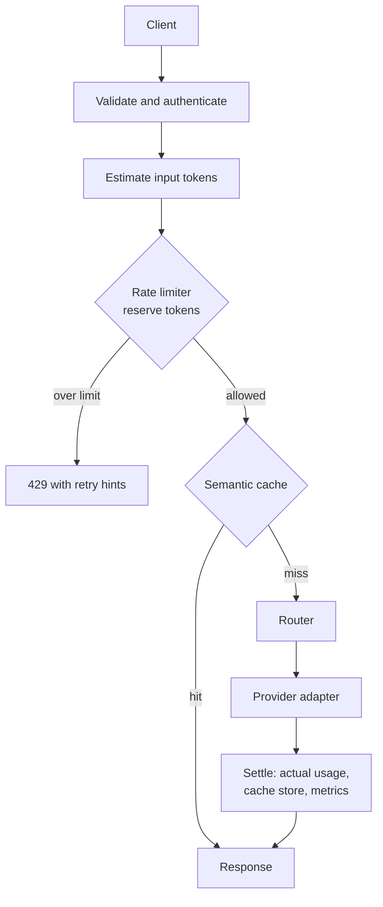

# Architecture

**Status:** Phase 1 in progress. The app serves `GET /health` and `POST /v1/chat/completions`, which answers
from a mock provider (tasks T-000 to T-102); there is no authentication, rate limiting, routing or caching yet.
Everything in sections 2 to 4 describes the target design, not current code.
Decisions behind it are recorded in [DECISIONS.md](DECISIONS.md); work in progress is in [TASKS.md](TASKS.md).

## 1. Overview

Tollgate is an LLM gateway: one OpenAI-compatible HTTP API in front of several model providers. It adds three
things that a plain proxy lacks:

- **Token-aware rate limiting.** Limits are counted in tokens per time window, not only requests, per API key.
- **Model routing.** Each request is sent to a provider and model chosen by explicit rules (cost, size, health).
- **Semantic caching.** A request that is close in meaning to an earlier one can be answered from the cache.

It is a portfolio project. Every performance or cost claim must come from a reproducible run (see section 6).

## 2. Request flow (target)



| Stage | Responsibility | Introduced |
| --- | --- | --- |
| API layer | `/v1/chat/completions`, `/health`, request and response models, error shape | Phase 0-1 |
| Providers | Adapters behind one interface: mock, then Ollama, then OpenAI and Anthropic | Phase 1-2 |
| Token counting | Estimate before the call, settle with the provider's reported usage after | Phase 1 |
| Rate limiter | Per-key token budget per window, state in Redis; the Redis client choice is decided in an ADR | Phase 1 |
| Router | Rule-based choice of provider and model, with fallback when a provider fails | Phase 2 |
| Semantic cache | Embedding of the prompt, similarity lookup, thresholds and invalidation | Phase 3 |
| Operations | Docker Compose, metrics, structured logs, load benchmarks | Phase 4 |

## 3. Core interfaces (target, Phase 1 onwards)

Illustrative signatures; names are final only once an ADR or task card fixes them.

```python
class Clock(Protocol):
    def now_seconds(self) -> float: ...        # injected everywhere; tests use a fake

class Provider(Protocol):
    async def complete(self, request: ChatRequest) -> ChatResponse: ...

class RateLimiter(Protocol):
    async def reserve(self, key: str, estimated_tokens: int) -> Decision: ...
    async def settle(self, key: str, reserved_tokens: int, actual_tokens: int) -> None: ...

class Router(Protocol):
    def select(self, request: ChatRequest) -> Route: ...

class SemanticCache(Protocol):
    async def get(self, request: ChatRequest) -> ChatResponse | None: ...
    async def put(self, request: ChatRequest, response: ChatResponse) -> None: ...
```

Interface changes require an ADR.

## 4. External contract

The public HTTP API is OpenAI-compatible for chat completions (ADR-0004). A snapshot of the generated OpenAPI
document is committed, and a test fails when it changes unless the task allows it (task T-004). This is the
project's equivalent of a frozen baseline: callers can rely on the contract, and a change to it is always
deliberate.

## 5. Repository layout

| Path | Contents | Committed |
| --- | --- | --- |
| `app/` | Gateway code | yes |
| `tests/` | Unit, integration and contract tests; no network access | yes |
| `scripts/` | Cross-platform helper scripts, such as `check.py` | yes |
| `docs/` | Architecture, decisions, tasks, setup | yes |
| `.githooks/` | Commit guards (identity, message, blocked files); need Node.js | yes |
| `.github/workflows/` | CI | yes |
| `.venv/` | Local virtual environment | no |

Package layout inside `app/` is decided per phase. Current: `app/api/` (request and response models, the error
body and handler, the chat router) and `app/providers/` (the `Provider` protocol and `MockProvider`), plus
`clock.py`, `settings.py` and `main.py`. Planned: `limits/`, `routing/`, `cache/`. The OpenAPI document omits
FastAPI's automatic 422, because the API answers 400 (ADR-0008), so `create_app()` builds a small `FastAPI`
subclass that strips it.

## 6. Conventions

- **Language and tools:** Python 3.13. ruff for lint and format, mypy in strict mode, pytest (ADR-0003).
  One command runs everything: `python scripts/check.py`.
- **Shell:** commands in the docs work in Git Bash on Windows. Use `.venv/Scripts/python -m ...`, never the
  MSYS2 `python`, which has no prebuilt wheels for compiled dependencies.
- **Units in names:** `tokens`, `seconds`, `milliseconds`, `usd` appear in names (`window_seconds`,
  `estimated_tokens`). No bare numbers that could mean either.
- **Time:** code never calls `time.time()` or `asyncio.sleep` directly where logic depends on it; it takes a
  `Clock`. Tests advance a fake clock instead of waiting.
- **Tests never touch the network or a paid API.** Providers are mocked or faked; Redis is replaced by an
  in-process fake unless an ADR says otherwise. Real provider calls happen only by hand.
- **Secrets:** read from environment variables only; never committed, never logged. `.env.example` lists names
  without values.
- **Evidence-first claims:** a latency, throughput, hit-rate or cost figure in a README or PR comes from a
  recorded run with its configuration stated. Unknown means "unknown".
- **Dependencies:** each one is listed in the task that needs it. Runtime and dev dependencies are separate.
