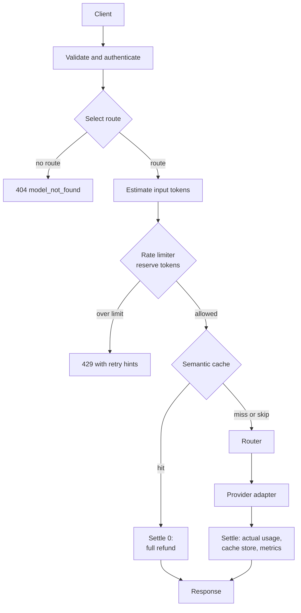

# Architecture

**Status:** Phase 3 complete. The app serves `GET /health` and `POST /v1/chat/completions`, which is routed by
model through a route table to the mock, Ollama, OpenAI or Anthropic provider with ordered fallback, behind API
key authentication and token-aware rate limiting (tasks T-000 to T-210). With the cache on, it answers a
request close in meaning to an earlier one from an in-process semantic cache (T-301 to T-307); no similarity
threshold is recommended, because the one embedding model evaluated found none (`cache-eval.md`).
Everything in sections 2 to 4 describes the target design, not current code.
Decisions behind it are recorded in [DECISIONS.md](DECISIONS.md); work in progress is in [TASKS.md](TASKS.md).

## 1. Overview

Tollgate is an LLM gateway: one OpenAI-compatible HTTP API in front of several model providers. It adds three
things that a plain proxy lacks:

- **Token-aware rate limiting.** Limits are counted in tokens per time window, not only requests, per API key.
- **Model routing.** Each request is sent to a provider and model chosen by explicit rules (cost, size, health).
- **Semantic caching.** A request that is close in meaning to an earlier one can be answered from the cache.

It is a portfolio project. Every performance or cost claim must come from a reproducible run (see section 6).

## 2. Request flow (target)



| Stage | Responsibility | Introduced |
| --- | --- | --- |
| API layer | `/v1/chat/completions`, `/health`, request and response models, error shape | Phase 0-1 |
| Providers | Adapters behind one interface: mock, then Ollama, then OpenAI and Anthropic | Phase 1-2 |
| Token counting | Estimate before the call, settle with the provider's reported usage after | Phase 1 |
| Rate limiter | Per-key token bucket, state in Redis through redis-py and one Lua script (ADR-0006) | Phase 1 |
| Router | Route table by model alias (ADR-0011); targets tried in order, each once, moving on only after a retryable failure (ADR-0010); a failed route is refunded, an untranslatable answer charged | Phase 2 |
| Semantic cache | Looked up after the reservation under the caller id; embedding of the last user message, similarity lookup, thresholds and invalidation; a hit settles 0, and only a `stop` answer of at most 65,536 bytes after a miss is stored (ADR-0014, ADR-0015) | Phase 3 |
| Operations | A pinned non-root image, a Docker Compose stack (gateway and Redis, Ollama optional) checked in CI, metrics, structured logs, load benchmarks (ADR-0016, ADR-0017) | Phase 4 |

## 3. Core interfaces (target, Phase 1 onwards)

Names are final once an ADR or task card fixes them. `Clock`, `Provider`, `TokenEstimator`,
`reserved_tokens`, `Decision` and `RateLimiter` are final (tasks T-101 to T-105); `ProviderError`,
`Route` and `Router` are final (T-201, T-202); `Embedder`, `EmbeddingError`, `SemanticCache`, `Hit`, `Miss`
and `Skip` are final (T-301 to T-306, ADR-0014, ADR-0015). `MonotonicClock`, `ReplyTooLargeError`,
`Attempt`, `AttemptOutcome` and `Skip.reason` are final (T-401, ADR-0016).

```python
class Clock(Protocol):
    def now_seconds(self) -> float: ...        # injected everywhere; tests use a fake

class MonotonicClock(Protocol):
    def monotonic_seconds(self) -> float: ...  # differences only, never goes back; the system one
                                               # reads time.perf_counter(); times each provider call

class Provider(Protocol):
    async def complete(self, request: ChatRequest) -> ChatResponse: ...

class TokenEstimator(Protocol):
    def estimate_input_tokens(self, request: ChatRequest) -> int: ...

def reserved_tokens(request: ChatRequest, estimator: TokenEstimator) -> int: ...
# the estimate plus max_completion_tokens, else max_tokens, else 0; this is what reserve() receives

@dataclass(frozen=True, slots=True)
class Decision:
    allowed: bool
    limit_tokens: int                          # the bucket capacity
    remaining_tokens: int                      # after the decision, rounded down, never below 0
    retry_after_seconds: int | None            # rounded up; None if allowed or larger than the capacity
    reset_seconds: int                         # until the bucket is full again, rounded up

class RateLimiter(Protocol):
    async def reserve(self, key: str, estimated_tokens: int) -> Decision: ...
    async def settle(self, key: str, reserved_tokens: int, actual_tokens: int) -> None: ...

class ProviderError(Exception):
    kind: ProviderErrorKind                    # connection, timeout, rate_limited,
                                               # upstream_status, bad_response
    status_code: int | None
    @property
    def retryable(self) -> bool: ...           # connection, timeout, rate_limited, and
                                               # upstream_status from 500 up

class ReplyTooLargeError(ProviderError):       # a 2xx reply passed the size cap; always a
    def __init__(self, status_code: int): ...  # bad_response, so existing callers are unchanged

type AttemptOutcome = Literal["ok", "connection", "timeout", "rate_limited", "upstream_status",
                              "bad_response", "reply_too_large", "error"]  # error: not a ProviderError

@dataclass(frozen=True, slots=True)
class Attempt:                                 # one provider call
    provider_name: str
    outcome: AttemptOutcome
    duration_seconds: float                    # on the MonotonicClock

# Served(completion, provider_name, fallbacks, attempts) and RouteFailed(charged, attempts) hold every
# Attempt in call order; run_route(route, providers, request, *, monotonic_clock) returns one of them.

type Route = tuple[TargetConfig, ...]          # ordered targets: a provider name and an
                                               # optional upstream model

class Router(Protocol):
    def select(self, request: ChatRequest) -> Route: ...   # alias, else default,
                                                           # else UnknownModelError

class Embedder(Protocol):
    @property
    def identity(self) -> str: ...             # type and model, such as "ollama:all-minilm"
    async def embed(self, text: str) -> array[float]: ...   # a unit vector

class EmbeddingError(Exception):               # not a ProviderError, so no fallback catches it
    kind: ProviderErrorKind
    status_code: int | None

@dataclass(frozen=True, slots=True)
class Hit:
    response: ChatResponse
    provider_name: str                         # the provider that produced the stored answer
    similarity: float

@dataclass(frozen=True, slots=True)
class Miss:
    ticket: Ticket                             # the partition key and the vector, for store()

@dataclass(frozen=True, slots=True)
class Skip:
    reason: Literal["not_eligible", "embedder_failed"]

class SemanticCache(Protocol):
    async def lookup(self, caller_id: str, request: ChatRequest) -> Hit | Miss | Skip: ...
    def store(self, ticket: Ticket, response: ChatResponse, provider_name: str) -> bool: ...
```

Interface changes require an ADR.

## 4. External contract

The public HTTP API is OpenAI-compatible for chat completions (ADR-0004). A snapshot of the generated OpenAPI
document is committed, and a test fails when it changes unless the task allows it (task T-004). This is the
project's equivalent of a frozen baseline: callers can rely on the contract, and a change to it is always
deliberate.

## 5. Repository layout

| Path | Contents | Committed |
| --- | --- | --- |
| `app/` | Gateway code | yes |
| `tests/` | Unit, integration and contract tests; no network access | yes |
| `scripts/` | Cross-platform helper scripts, such as `check.py`, `eval_cache.py` (the cache eval run), `fake_upstream.py` (a fake OpenAI-compatible upstream with a fixed delay) and `bench_load.py` (the fixed-rate load runner, ADR-0018) | yes |
| `eval/` | Fixed datasets for measurements: `cache_pairs.json`, the cache eval pairs | yes |
| `deploy/` | Deployment files: `logging.json` (the `uvicorn --log-config` file), `routes.compose.json` (the Compose route table, mock provider only) and `bench/` (the load benchmark's route tables: `routes.fake-upstream.json` for scenario B, `routes.mock.json` for scenario C) | yes |
| `Dockerfile`, `.dockerignore`, `compose.yaml` | The gateway image and the one-host stack (section 5.1) | yes |
| `docs/` | Architecture, decisions, tasks, setup | yes |
| `.githooks/` | Commit guards (identity, message, blocked files); need Node.js | yes |
| `.github/workflows/` | CI | yes |
| `.venv/` | Local virtual environment | no |

### 5.1 Image and deployment target (ADR-0017)

- **Image.** Multi-stage `Dockerfile` on `python:3.13-slim` pinned by digest. `/app` holds `.venv`, `app/` and
  `deploy/logging.json` only; `.dockerignore` excludes everything except those inputs. It runs as uid 10001 and
  starts uvicorn in exec form, so uvicorn is PID 1 and receives SIGTERM, with one worker.
- **Compose stack.** `gateway` (Redis limiter, `/health` healthcheck, published on `127.0.0.1:8000` only) and
  `redis` (`redis:7.4.12`, no published port). `TOLLGATE_API_KEYS` and `TOLLGATE_METRICS_TOKEN` are required
  `${VAR:?...}` references, never written in the file. The route table is mounted read-only at
  `/config/routes.json`, outside `/app`. An `ollama` service sits in the `ollama` profile, off by default.
- **CI.** The `container` job lints the `Dockerfile` with hadolint, builds and starts the stack, runs
  `scripts/smoke_container.py`, and checks Redis keys, the JSON log line, the non-root user, the contents of
  `/app` and a graceful stop. Its key and token are random per run.
- **Deployment target.** One host running this stack, one gateway process per container. More gateway
  containers need `TOLLGATE_LIMITER_BACKEND=redis`; the cache and the metrics stay per process. The gateway
  serves no TLS; a reverse proxy outside this repository terminates it. No hosted deployment in Phase 4.

Package layout inside `app/` is decided per phase. Current: `app/api/` (request and response models, the error
body and handler, API key authentication, the rate-limit headers in `limit_headers.py`, the chat router) and
`app/providers/` (the `Provider` protocol, `MockProvider`, `ProviderError` with its failure kinds in
`errors.py`, the Ollama adapter `OllamaProvider` in `ollama.py`, the OpenAI adapter `OpenAIProvider` in
`openai.py`, the Anthropic adapter `AnthropicProvider` in `anthropic.py`, `fields.py`: the reply checks the
adapters share, and `http_body.py`: `read_capped`, which reads a 2xx body in decoded chunks up to the
provider's `max_response_bytes` (ADR-0013), and `post_json`, beside it, the one request with its status and
failure mapping), `app/routing/` (`config.py`: the route table file, validated when the settings are read,
and the built-in table; `router.py`: `Route`, `Router`, `TableRouter` and `run_route`, the ordered fallback
loop),
`app/limits/` (the token estimator, the `RateLimiter` interface, `charge.py` (`charged_tokens`: the settle
charge capped at the bucket capacity, ADR-0012), the in-memory token
bucket, and the Redis token bucket: `redis_limiter.py` running `token_bucket.lua`, unit-tested against
fakeredis), plus `clock.py`, `settings.py` and `main.py`. The shared limiter
behaviour suite is `tests/limits/behaviour.py`; every limiter's test module runs it. `app/cache/` holds the
semantic cache: `embedder.py` (the `Embedder` protocol and `EmbeddingError`), `ollama_embedder.py`
(`OllamaEmbedder`, `POST /api/embed` through `post_json`), `hashing.py` (`HashingEmbedder`, the lexical
baseline for tests and the eval, never selectable at run time), `semantic.py` (`SemanticCache`, `Hit`, `Miss`,
`Skip`, `Ticket`, `partition_key` and `InMemorySemanticCache`: partitions, a `math.sumprod` scan, expiry and
eviction) and `evaluation.py`, the eval harness that measures hit and wrong-hit rates on
`eval/cache_pairs.json` (`docs/cache-eval.md`). `app/observability/` holds the request log (ADR-0016):
`record.py`, `middleware.py` and `logs.py`, described below.
The OpenAPI document omits FastAPI's automatic 422, because the
API answers 400 (ADR-0008), so `create_app()` builds a small `FastAPI` subclass that strips it. Authentication
has two parts: the chat router's `AuthenticatedRoute` checks the key before the body is read, so a caller
without a key never sees a validation error, and the `require_api_key` dependency returns the caller identity
and makes the OpenAPI document record the bearer scheme.

`create_app()` also builds the `HeuristicEstimator` and the limiter chosen by `TOLLGATE_LIMITER_BACKEND`, on
the injected clock, and keeps them on `app.state`: `InMemoryRateLimiter`, or `RedisRateLimiter` on an optional
injected Redis client (tests pass fakeredis) or one built from `TOLLGATE_REDIS_URL`, kept on
`app.state.redis_client`. Every client `create_app()` builds (one `httpx.AsyncClient` per HTTP provider of the route table, then the
embedder's client when the cache is on, then the Redis client built from the URL; an injected client is the caller's) is appended to
`app.state.owned_clients`, and the app lifespan closes the
list at shutdown, last built first. A close that raises does not stop the others; once all have been tried the
errors are raised together as an `ExceptionGroup`, so a failure is never hidden. It also builds the provider
registry (provider name to `Provider`: a `MockProvider` per `mock` entry, an `OllamaProvider` per `ollama`
entry, an `OpenAIProvider` per `openai` entry with the key read from its `api_key_env`, and an
`AnthropicProvider` per `anthropic` entry with its key and `default_max_tokens`; the mock, Ollama and Anthropic
ones on the injected clock and one shared id source; the HTTP ones each on their own client with the ADR-0010 timeouts, their
provider's default base URL when `base_url` is absent or empty, their `max_response_bytes` and the
`http_transport=` keyword's transport, which tests set to an
`httpx.MockTransport`; every route table type has a branch, which mypy checks through `assert_never`) and a
`TableRouter` on the route table, kept on
`app.state.providers` and `app.state.router`. The `provider=` keyword sets the entry named `mock` and
`providers=` then sets entries by name; an entry the route table does not name is never routed to. With the
cache on (`TOLLGATE_CACHE_EMBEDDER`), it builds an `OllamaEmbedder` on its own client, or takes the injected
`embedder=`, kept on `app.state.embedder`, and an `InMemorySemanticCache` on it and the clock, kept on
`app.state.cache`; both are `None` with the cache off. The id source the providers share is kept on
`app.state.id_source`. The chat route reads the registry, the router, the limiter, the cache, the id source,
the clock and the monotonic clock (`monotonic_clock=`, else a `SystemMonotonicClock`) from `app.state` on
every request. It selects the route first, answering a model that no route
serves with the ADR-0011 404 before any estimate or reservation, and with no limit headers. It then
reserves the estimate plus the completion allowance under the caller id and answers a refusal with 429, so
a 404, 400 or 429 never reaches the embedder. With the cache on it then looks the request up under the caller
id (ADR-0014). A hit runs no target and settles once with 0, refunding the reservation in full, and answers
the stored response with a new `id` from the id source and `created` from the clock, `x-tollgate-provider`
naming the provider that produced the stored answer and `x-tollgate-fallbacks: 0`. A miss runs the route, and
after the settle its 200 is offered to `store`, which keeps only a single `stop` choice of at most 65,536 bytes of JSON. A skip (not eligible,
or an `EmbeddingError`) runs the route as if the cache were off; any other exception from the lookup is a 500.
Every 200, and no other status, carries `x-tollgate-cache`: `hit`, `miss` or `skip`.
`run_route` tries each target once, in order, with the request's `model` replaced by the target's upstream
model (the client's when it has none), and moves on only after a retryable `ProviderError`. It times
each call on the monotonic clock and returns an `Attempt` for every call, whatever its outcome; the
request log and the metrics (below) report them. A 200 settles
once with the serving attempt's `usage.total_tokens`, capped at the bucket capacity (`charged_tokens` with the
reserve decision's `limit_tokens`, ADR-0012) while the response's `usage` is returned unchanged, keeps the body
`model` the provider reported, and carries `x-tollgate-provider` and `x-tollgate-fallbacks`. A route that ends without an answer gives the
ADR-0008 502: the whole reservation is refunded, except after a `bad_response`, which is charged as
reserved (ADR-0010). Only the provider calls are guarded, so a limiter error is a 500, never a refund.
The limit headers come from the `Decision` that `reserve` returned, so a 200 shows the balance after the
reservation and a 502 the balance before the settle; the next request sees the settled balance.

Every HTTP request writes one JSON line to the logger `tollgate.request` (ADR-0016). The chat route creates a
`ChatRecord` (`app/observability/record.py`) in the ASGI scope's `state`, so the record belongs to one request,
and fills it as each step runs: the serving provider and the fallbacks, the cache result and the skip reason,
the reserved and charged tokens, whether the settle was capped (the reported total was above the capacity),
the attempts and the cache lookup's duration. A field stays `None` until its step has run, so a 404 or a 429
has null chat fields, a cache hit has no attempts, a 502 has no serving provider, and a cache that is off has
no cache result. `RequestMiddleware` (`middleware.py`) is a pure ASGI middleware, added by `create_app()`. It
times the request on the monotonic clock, reads the status from `http.response.start`, and reports once the
app has returned, so the duration includes sending the body. A handler that raises is reported once, with
the status already sent or 500, and the exception propagates; a cancelled request is not logged. It maps the path to `/v1/chat/completions`,
`/health` or `/metrics` exactly, and everything else, FastAPI's documentation routes included, to `other`.
The result goes to its observers, `log_request` first and the metrics second. `JsonFormatter` (`logs.py`)
writes the ADR-0016 fields for `tollgate.request`, and only `time`, `level`, `logger`, `message` and
`exception_type` for any other logger, never an exception's message or traceback. It uses `ensure_ascii`,
so a line is one ASCII line. The app installs no handler: `deploy/logging.json` is the `dictConfig` file for
`uvicorn --log-config`. It sends `tollgate.request` and uvicorn's loggers to stdout through `JsonFormatter`,
and silences `uvicorn.access`, whose message holds the path, the query string and the client address.
`create_app()` also turns FastAPI's native telemetry off (`NATIVE_TELEMETRY_OFF` in `app/main.py`).

The metrics (ADR-0016) live in one `MetricsRegistry` per app, on `app.state.metrics`, built by
`build_request_metrics` (`app/observability/request_metrics.py`) from the route table's provider names; it is
never a module-level object. Its `observe` is the middleware's second observer and reads only the request
result: the path and status feed the request counter and duration histogram, a 200 with a serving provider
feeds `tollgate_chat_completions_total` (`off` when no lookup ran), each attempt feeds the attempt counter and
histogram, a lookup feeds `tollgate_cache_lookups_total` by its result or skip reason, and the reserved and
charged tokens (the charge already capped) and a capped settle feed the three token counters. Label sets known
at startup are exported at 0; `status` is the one label that appears on first use. No label is `method`, which
the log carries as received. `GET /metrics` (`app/observability/endpoint.py`) is registered only when
`TOLLGATE_METRICS_TOKEN` is set, is left out of the OpenAPI document, and answers with the registry's text
format. It accepts exactly one `Authorization: Bearer <token>` and compares SHA-256 digests with
`hmac.compare_digest`; anything else is a 401 with code `invalid_metrics_token`. A scrape is counted after it is
rendered, so it never shows itself. With the token unset, `/metrics` is an ordinary 404 and counts as `other`.

The Redis token bucket keeps one hash per API key at a prefix plus the SHA-256 digest of the key
(default prefix `tollgate:bucket:`), so the key itself is never written to Redis. The hash holds
`balance_units` (tokens x 60000) and `updated_milliseconds`; in those units one millisecond refills
exactly `tokens_per_minute` units, so the script works only with integers below 2^53 and agrees with
the exact in-memory reference. The script takes the time from the injected `Clock`, rounded down to
whole milliseconds, never from the server, and returns the balance as the fraction string
`"<n>/60000"`. `capacity_tokens` and `tokens_per_minute` are each at most 75,059,993,789, and a
charge stops at a debt of that many tokens, which the in-memory limiter does not. Each call sets
the key to expire once the bucket would be full again plus 60 seconds, because a missing key starts
full. Calls that reach Redis out of order are handled like a clock that steps back: no refill, and
the timestamp never moves back.

## 6. Conventions

- **Language and tools:** Python 3.13. ruff for lint and format, mypy in strict mode, pytest (ADR-0003).
  One command runs everything: `python scripts/check.py`.
- **Shell:** commands in the docs work in Git Bash on Windows. Use `.venv/Scripts/python -m ...`, never the
  MSYS2 `python`, which has no prebuilt wheels for compiled dependencies.
- **Units in names:** `tokens`, `seconds`, `milliseconds`, `usd` appear in names (`window_seconds`,
  `estimated_tokens`). No bare numbers that could mean either.
- **Time:** code never calls `time.time()` or `asyncio.sleep` directly where logic depends on it; it takes a
  `Clock`. Tests advance a fake clock instead of waiting.
- **Tests never touch the network or a paid API.** Providers are mocked or faked; Redis is replaced by an
  in-process fake unless an ADR says otherwise. Real provider calls happen only by hand.
- **Secrets:** read from environment variables only; never committed, never logged. `.env.example` lists names
  without values.
- **Evidence-first claims:** a latency, throughput, hit-rate or cost figure in a README or PR comes from a
  recorded run with its configuration stated. Unknown means "unknown".
- **Dependencies:** each one is listed in the task that needs it. Runtime and dev dependencies are separate.
