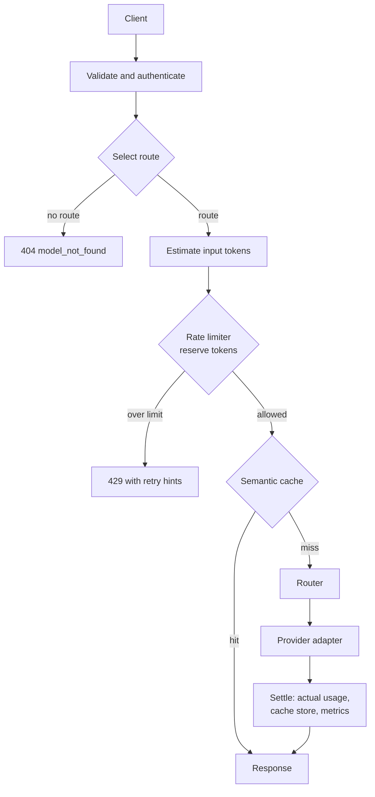

# Architecture

**Status:** Phase 1 in progress. The app serves `GET /health` and `POST /v1/chat/completions`, which answers
from a mock provider, behind API key authentication and token-aware rate limiting (tasks T-000 to T-108);
there is no routing or caching yet.
Everything in sections 2 to 4 describes the target design, not current code.
Decisions behind it are recorded in [DECISIONS.md](DECISIONS.md); work in progress is in [TASKS.md](TASKS.md).

## 1. Overview

Tollgate is an LLM gateway: one OpenAI-compatible HTTP API in front of several model providers. It adds three
things that a plain proxy lacks:

- **Token-aware rate limiting.** Limits are counted in tokens per time window, not only requests, per API key.
- **Model routing.** Each request is sent to a provider and model chosen by explicit rules (cost, size, health).
- **Semantic caching.** A request that is close in meaning to an earlier one can be answered from the cache.

It is a portfolio project. Every performance or cost claim must come from a reproducible run (see section 6).

## 2. Request flow (target)



| Stage | Responsibility | Introduced |
| --- | --- | --- |
| API layer | `/v1/chat/completions`, `/health`, request and response models, error shape | Phase 0-1 |
| Providers | Adapters behind one interface: mock, then Ollama, then OpenAI and Anthropic | Phase 1-2 |
| Token counting | Estimate before the call, settle with the provider's reported usage after | Phase 1 |
| Rate limiter | Per-key token bucket, state in Redis through redis-py and one Lua script (ADR-0006) | Phase 1 |
| Router | Route table by model alias (ADR-0011); targets tried in order, each once, moving on only after a retryable failure (ADR-0010); a failed route is refunded, an untranslatable answer charged | Phase 2 |
| Semantic cache | Embedding of the prompt, similarity lookup, thresholds and invalidation | Phase 3 |
| Operations | Docker Compose, metrics, structured logs, load benchmarks | Phase 4 |

## 3. Core interfaces (target, Phase 1 onwards)

Names are final once an ADR or task card fixes them. `Clock`, `Provider`, `TokenEstimator`,
`reserved_tokens`, `Decision` and `RateLimiter` are final (tasks T-101 to T-105); `ProviderError`,
`Route` and `Router` are final (T-201, T-202); `SemanticCache` is still illustrative.

```python
class Clock(Protocol):
    def now_seconds(self) -> float: ...        # injected everywhere; tests use a fake

class Provider(Protocol):
    async def complete(self, request: ChatRequest) -> ChatResponse: ...

class TokenEstimator(Protocol):
    def estimate_input_tokens(self, request: ChatRequest) -> int: ...

def reserved_tokens(request: ChatRequest, estimator: TokenEstimator) -> int: ...
# the estimate plus max_completion_tokens, else max_tokens, else 0; this is what reserve() receives

@dataclass(frozen=True, slots=True)
class Decision:
    allowed: bool
    limit_tokens: int                          # the bucket capacity
    remaining_tokens: int                      # after the decision, rounded down, never below 0
    retry_after_seconds: int | None            # rounded up; None if allowed or larger than the capacity
    reset_seconds: int                         # until the bucket is full again, rounded up

class RateLimiter(Protocol):
    async def reserve(self, key: str, estimated_tokens: int) -> Decision: ...
    async def settle(self, key: str, reserved_tokens: int, actual_tokens: int) -> None: ...

class ProviderError(Exception):
    kind: ProviderErrorKind                    # connection, timeout, rate_limited,
                                               # upstream_status, bad_response
    status_code: int | None
    @property
    def retryable(self) -> bool: ...           # connection, timeout, rate_limited, and
                                               # upstream_status from 500 up

type Route = tuple[TargetConfig, ...]          # ordered targets: a provider name and an
                                               # optional upstream model

class Router(Protocol):
    def select(self, request: ChatRequest) -> Route: ...   # alias, else default,
                                                           # else UnknownModelError

class SemanticCache(Protocol):
    async def get(self, request: ChatRequest) -> ChatResponse | None: ...
    async def put(self, request: ChatRequest, response: ChatResponse) -> None: ...
```

Interface changes require an ADR.

## 4. External contract

The public HTTP API is OpenAI-compatible for chat completions (ADR-0004). A snapshot of the generated OpenAPI
document is committed, and a test fails when it changes unless the task allows it (task T-004). This is the
project's equivalent of a frozen baseline: callers can rely on the contract, and a change to it is always
deliberate.

## 5. Repository layout

| Path | Contents | Committed |
| --- | --- | --- |
| `app/` | Gateway code | yes |
| `tests/` | Unit, integration and contract tests; no network access | yes |
| `scripts/` | Cross-platform helper scripts, such as `check.py` | yes |
| `docs/` | Architecture, decisions, tasks, setup | yes |
| `.githooks/` | Commit guards (identity, message, blocked files); need Node.js | yes |
| `.github/workflows/` | CI | yes |
| `.venv/` | Local virtual environment | no |

Package layout inside `app/` is decided per phase. Current: `app/api/` (request and response models, the error
body and handler, API key authentication, the rate-limit headers in `limit_headers.py`, the chat router) and
`app/providers/` (the `Provider` protocol, `MockProvider`, and `ProviderError` with its failure kinds in
`errors.py`), `app/routing/` (`config.py`: the route table file, validated when the settings are read, and the
built-in table; `router.py`: `Route`, `Router`, `TableRouter` and `run_route`, the ordered fallback loop),
`app/limits/` (the token estimator, the `RateLimiter` interface, the in-memory token
bucket, and the Redis token bucket: `redis_limiter.py` running `token_bucket.lua`, unit-tested against
fakeredis), plus `clock.py`, `settings.py` and `main.py`. The shared limiter
behaviour suite is `tests/limits/behaviour.py`; every limiter's test module runs it. Planned: `cache/`.
The OpenAPI document omits FastAPI's automatic 422, because the
API answers 400 (ADR-0008), so `create_app()` builds a small `FastAPI` subclass that strips it. Authentication
has two parts: the chat router's `AuthenticatedRoute` checks the key before the body is read, so a caller
without a key never sees a validation error, and the `require_api_key` dependency returns the caller identity
and makes the OpenAPI document record the bearer scheme.

`create_app()` also builds the `HeuristicEstimator` and the limiter chosen by `TOLLGATE_LIMITER_BACKEND`, on
the injected clock, and keeps them on `app.state`: `InMemoryRateLimiter`, or `RedisRateLimiter` on an optional
injected Redis client (tests pass fakeredis) or one built from `TOLLGATE_REDIS_URL`, kept on
`app.state.redis_client`. Every client `create_app()` builds (so far only the Redis client built from the URL;
an injected client is the caller's) is appended to `app.state.owned_clients`, and the app lifespan closes the
list at shutdown, last built first. A close that raises does not stop the others; once all have been tried the
errors are raised together as an `ExceptionGroup`, so a failure is never hidden. The adapter tasks append their
HTTP clients the same way. It also builds the provider registry (provider name to `Provider`, one
`MockProvider` on the injected clock per `mock` entry of the route table; any type not built yet stops
startup with a `SettingsError` on `TOLLGATE_ROUTES_FILE`) and a `TableRouter` on the route table, kept on
`app.state.providers` and `app.state.router`. The `provider=` keyword sets the entry named `mock` and
`providers=` then sets entries by name; an entry the route table does not name is never routed to. The chat route reads the registry, the router and the
limiter from `app.state` on every request. It selects the route first, answering a model that no route
serves with the ADR-0011 404 before any estimate or reservation, and with no limit headers. It then
reserves the estimate plus the completion allowance under the caller id and answers a refusal with 429.
`run_route` tries each target once, in order, with the request's `model` replaced by the target's upstream
model (the client's when it has none), and moves on only after a retryable `ProviderError`. A 200 settles
once with the serving attempt's `usage.total_tokens`, keeps the body `model` the provider reported, and
carries `x-tollgate-provider` and `x-tollgate-fallbacks`. A route that ends without an answer gives the
ADR-0008 502: the whole reservation is refunded, except after a `bad_response`, which is charged as
reserved (ADR-0010). Only the provider calls are guarded, so a limiter error is a 500, never a refund.
The limit headers come from the `Decision` that `reserve` returned, so a 200 shows the balance after the
reservation and a 502 the balance before the settle; the next request sees the settled balance.

The Redis token bucket keeps one hash per API key at a prefix plus the SHA-256 digest of the key
(default prefix `tollgate:bucket:`), so the key itself is never written to Redis. The hash holds
`balance_units` (tokens x 60000) and `updated_milliseconds`; in those units one millisecond refills
exactly `tokens_per_minute` units, so the script works only with integers below 2^53 and agrees with
the exact in-memory reference. The script takes the time from the injected `Clock`, rounded down to
whole milliseconds, never from the server, and returns the balance as the fraction string
`"<n>/60000"`. `capacity_tokens` and `tokens_per_minute` are each at most 75,059,993,789, and a
charge stops at a debt of that many tokens, which the in-memory limiter does not. Each call sets
the key to expire once the bucket would be full again plus 60 seconds, because a missing key starts
full. Calls that reach Redis out of order are handled like a clock that steps back: no refill, and
the timestamp never moves back.

## 6. Conventions

- **Language and tools:** Python 3.13. ruff for lint and format, mypy in strict mode, pytest (ADR-0003).
  One command runs everything: `python scripts/check.py`.
- **Shell:** commands in the docs work in Git Bash on Windows. Use `.venv/Scripts/python -m ...`, never the
  MSYS2 `python`, which has no prebuilt wheels for compiled dependencies.
- **Units in names:** `tokens`, `seconds`, `milliseconds`, `usd` appear in names (`window_seconds`,
  `estimated_tokens`). No bare numbers that could mean either.
- **Time:** code never calls `time.time()` or `asyncio.sleep` directly where logic depends on it; it takes a
  `Clock`. Tests advance a fake clock instead of waiting.
- **Tests never touch the network or a paid API.** Providers are mocked or faked; Redis is replaced by an
  in-process fake unless an ADR says otherwise. Real provider calls happen only by hand.
- **Secrets:** read from environment variables only; never committed, never logged. `.env.example` lists names
  without values.
- **Evidence-first claims:** a latency, throughput, hit-rate or cost figure in a README or PR comes from a
  recorded run with its configuration stated. Unknown means "unknown".
- **Dependencies:** each one is listed in the task that needs it. Runtime and dev dependencies are separate.
